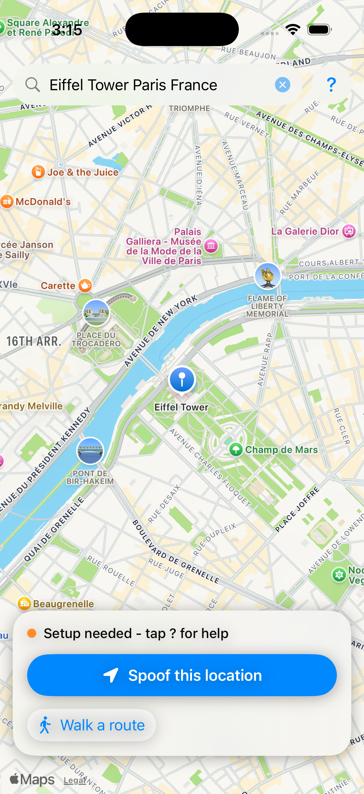
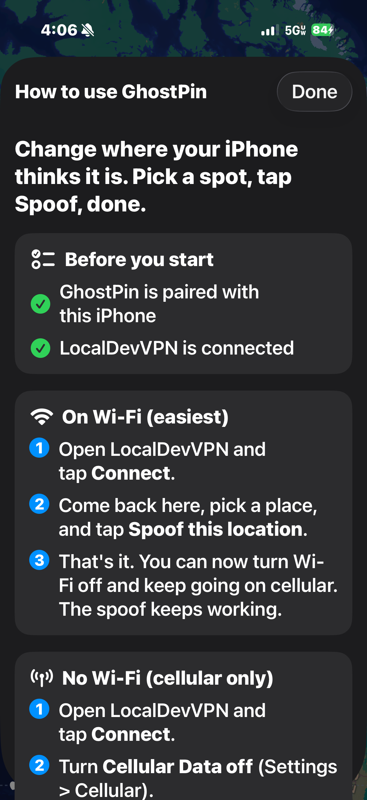

# GhostPin

Change your iPhone's GPS location **from the phone itself** - no computer needed after setup.
Pick a spot on the map, tap **Spoof this location**, or draw a route and tap **Start**.

  
  

## Install it (pick one)

| | Best for | Time |
|---|---|---|
| **[Let an AI do it for you](docs/INSTALL_WITH_AI.md)** (recommended) | Everyone. Paste one prompt into Codex or Claude and follow along. | ~20 min |
| **[Step by step by hand](docs/INSTALL_MANUAL.md)** | People who like doing it themselves. | ~30 min |

## What you need
- A Mac (any recent one) with a USB cable for your iPhone, one time
- An iPhone on iOS 17 or newer
- A free Apple ID (no paid developer account needed)
- About 15 GB free for Xcode (free from the Mac App Store)

## How it works (short version)
Apple lets developer tools fake a phone's location. GhostPin does that *on the phone* by talking to the
phone's own developer service through **LocalDevVPN**, a free app that makes a private loop-back tunnel on
the phone. The Mac is only needed for the one-time install and pairing.

## Using it (also built into the app: tap the **?**)
**On Wi-Fi (easiest)**
1. Open **LocalDevVPN** and tap **Connect**.
2. Open GhostPin, pick a place, tap **Spoof this location** (do it once to test).
3. Done. You can now turn Wi-Fi off and keep spoofing on cellular.

**No Wi-Fi (cellular only)**
1. Open **LocalDevVPN** and tap **Connect**.
2. Turn **Cellular Data off** (Settings > Cellular).
3. Open GhostPin, pick a place, tap **Spoof this location**.
4. Turn **Cellular Data back on**. The spoof stays on.

Tap **Stop & use my real location** to go back to normal. See the [full guide](docs/USING_GHOSTPIN.md).

## Good to know
- With a free Apple ID the app **expires after 7 days**. Just run the installer again (`scripts/install.sh`).
- LocalDevVPN must be **Connected** whenever you use GhostPin.
- If the spoof stops, reopen GhostPin and tap Spoof again.
- Use this on your own phone, for testing, privacy, or fun. Some apps and games forbid fake locations;
  that is your responsibility.
- Tested on iPhone 17 Pro with iOS 26.7.2. Other devices should work but are not tested.

## Credits and license
MIT licensed (see `LICENSE`). Uses the [idevice](https://github.com/jkcoxson/idevice) library by Jackson Coxson
(MIT), prebuilt in `Native/` from commit `8970209`, and [pymobiledevice3](https://github.com/doronz88/pymobiledevice3)
for the one-time pairing.
