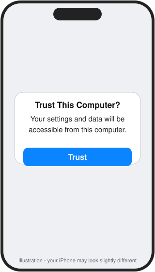
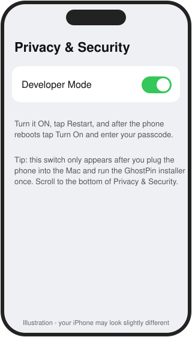
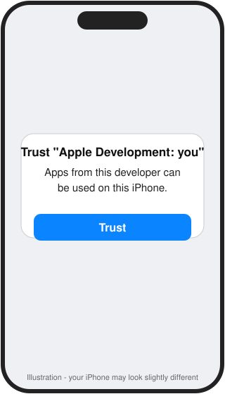
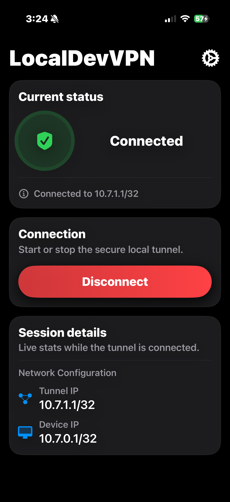
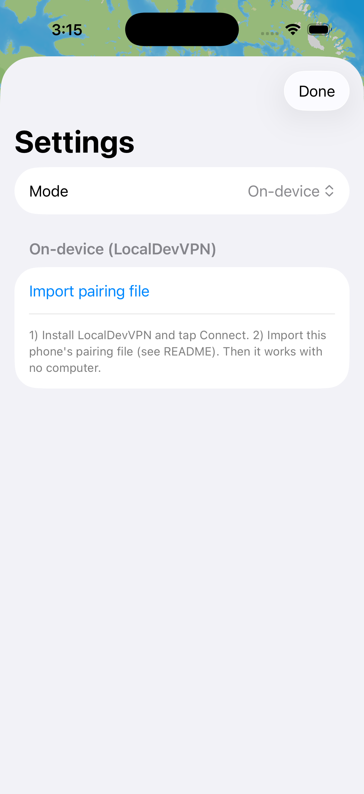
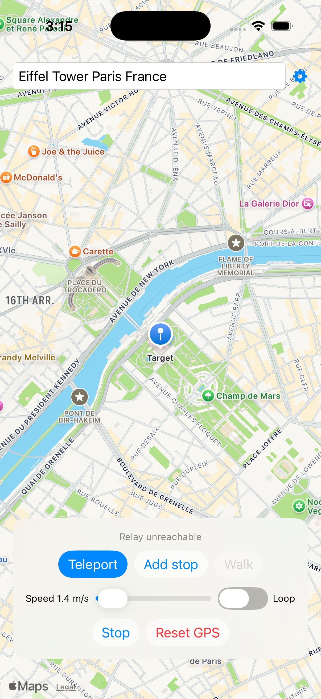

# Install GhostPin by hand

Takes about 30 minutes. You will copy and paste two commands into Terminal.

## 1. Install Xcode (free)
App Store > search **Xcode** > **Get**. When done, **open Xcode once** and accept anything it asks.

## 2. Sign in with your Apple ID in Xcode
Xcode menu > **Settings** > **Accounts** > **+** > **Apple ID**. A free Apple ID is fine.

## 3. Plug in your iPhone and Trust the Mac
Connect with a cable, unlock the phone, tap **Trust**, enter your passcode.



## 4. Open Terminal
Press **Command + Space**, type **Terminal**, press Enter. A white or black window opens.

## 5. Download GhostPin
Paste this and press Enter:

```bash
git clone https://github.com/WoofyDax/ghostpin.git ~/GhostPin && cd ~/GhostPin
```
(If a window asks to install "command line developer tools", click Install, wait, then paste it again.)

## 6. Turn on Developer Mode on the phone
Run the installer once (next step). If it stops and says "Turn on Developer Mode", do this on the iPhone, then run it again:
**Settings > Privacy & Security > scroll to the bottom > Developer Mode > On**, tap **Restart**, then **Turn On** and enter your passcode.



## 7. Run the installer
```bash
scripts/install.sh
```
- It asks for your **Mac password** (letters do not show as you type; that is normal).
- Keep your phone **unlocked** and plugged in.
- If it says it cannot find a developer team, do step 2, open `GhostPin.xcodeproj` once in Xcode, click the **GhostPin** target > **Signing & Capabilities** > choose your name under **Team**, then run it again.

## 8. Trust the app on the phone
iPhone **Settings > General > VPN & Device Management** > your Apple ID > **Trust**.



## 9. Install and start LocalDevVPN
App Store > search **LocalDevVPN** > Get. Open it and tap **Connect**. It should say **Connected**.



## 10. Use GhostPin
Open **GhostPin** > **gear** > **Mode: On-device** > search a place > **Teleport**.

 

Tap **Reset GPS** to return to your real location.

> **Wi-Fi needed.** GhostPin does not work with cellular only. See the README section "Wi-Fi vs cellular".

## Every 7 days
Free Apple IDs expire apps after 7 days. Plug in the phone and run `cd ~/GhostPin && scripts/install.sh` again.
