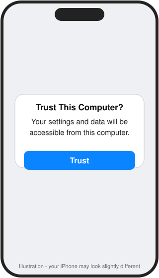
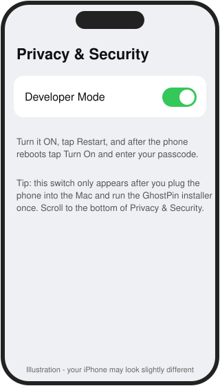
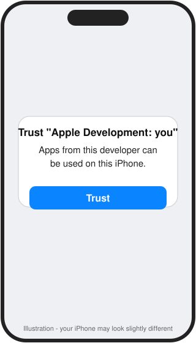
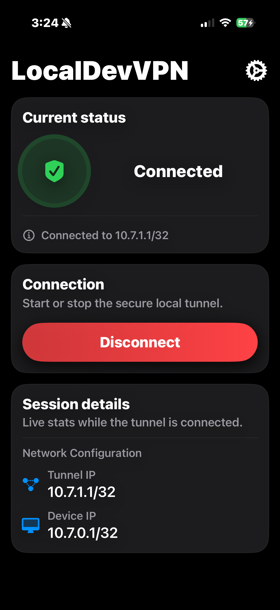
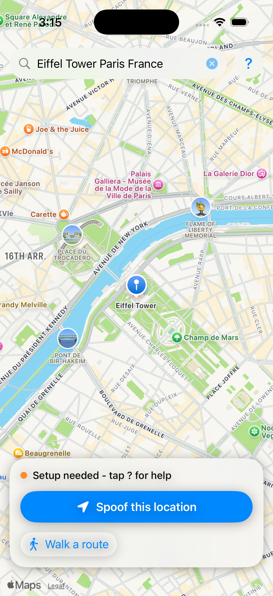
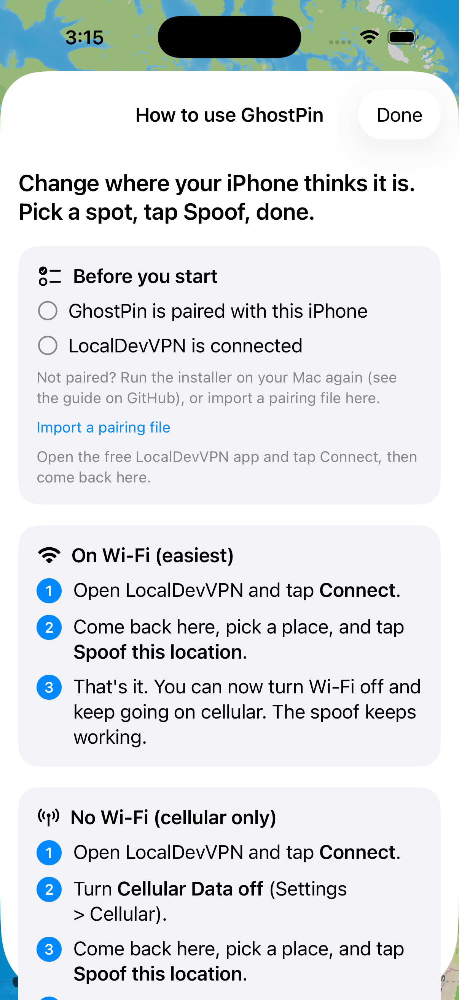

# Install GhostPin with an AI helper (easiest)

You will paste one prompt into a "coding agent" app. It does the Terminal work for you and tells you
exactly what to tap on your iPhone. You do not need to type any commands.

## Step 1 - Get an AI app (pick one)
- **ChatGPT app with Codex** (first choice): download the ChatGPT app for Mac from <https://openai.com/chatgpt/desktop/>, sign in, and open **Codex**.
- **Claude app with Claude Code**: download from <https://claude.ai/download>, sign in, and open the **Code** tab.

You need to be signed in to a plan that includes the coding agent.

## Step 2 - Get Xcode (free)
Open the **App Store** on your Mac, search **Xcode**, click **Get**, and wait (it is large).
When it finishes, **open Xcode once** and click **Agree** / **Install** if it asks.

## Step 3 - Plug in your iPhone
1. Use a USB cable to connect your iPhone to your Mac. **Unlock the phone.**
2. Your iPhone asks **"Trust This Computer?"** Tap **Trust** and type your phone passcode.

If no prompt appears, unplug and replug, or try another cable/port.

## Step 4 - Copy the prompt
Open **[PROMPT.md](../PROMPT.md)** and copy the text in the box (the **copy** button at the top-right of the box works).

## Step 5 - Paste it into the AI app
1. Start a **new chat/task** in Codex or Claude Code. Choose your **Home folder** (or any folder) as the project.
2. Set the permission mode to the most permissive one so it can run the setup without asking at every step:
   **Full access** in Codex, **Bypass permissions** in Claude. (It will still ask you for things only you can do.)
3. Paste the prompt and press **Enter**.

> Only use full-access mode for this prompt. It lets the AI run commands on your Mac without asking first.
> The prompt tells it to stay within the GhostPin steps.

## Step 6 - Follow along
The AI will tell you what to do when it needs you. Typical moments:

| When it says... | What you do |
|---|---|
| "Enter your Mac password" | Type it (you will not see letters appear) and press Enter |
| "Turn on Developer Mode" | iPhone **Settings > Privacy & Security > Developer Mode > On**, restart, confirm    |
| "Trust the developer app" | iPhone **Settings > General > VPN & Device Management** > your Apple ID > **Trust**    |
| "Install LocalDevVPN" | App Store > search **LocalDevVPN** > Get > open it > tap **Connect**    |

## Step 7 - Use it
Open **GhostPin**, search for a place or tap the map, and tap **Spoof this location**. Tap the **?** any time for the built-in how-to.

 

Tap **Stop & use my real location** to go back to normal. Remember: **LocalDevVPN must say Connected**.

**Using cellular?** Start LocalDevVPN while on Wi-Fi, spoof once, then turn Wi-Fi off. Or with no Wi-Fi: connect LocalDevVPN, turn Cellular Data off, tap Spoof, turn Cellular Data back on. Details: [USING_GHOSTPIN](USING_GHOSTPIN.md).

## Every 7 days
A free Apple ID makes the app expire after 7 days. Plug the phone in and ask the AI: *"Re-run scripts/install.sh in ~/GhostPin."*

Stuck? See [TROUBLESHOOTING](TROUBLESHOOTING.md) or use the [manual guide](INSTALL_MANUAL.md).
