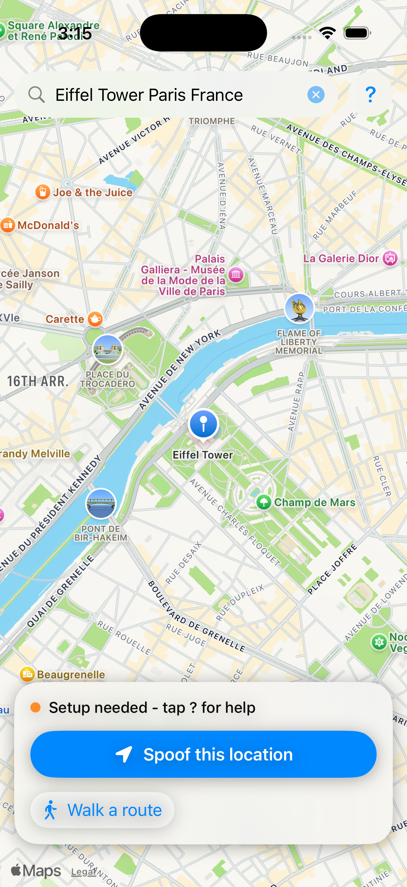
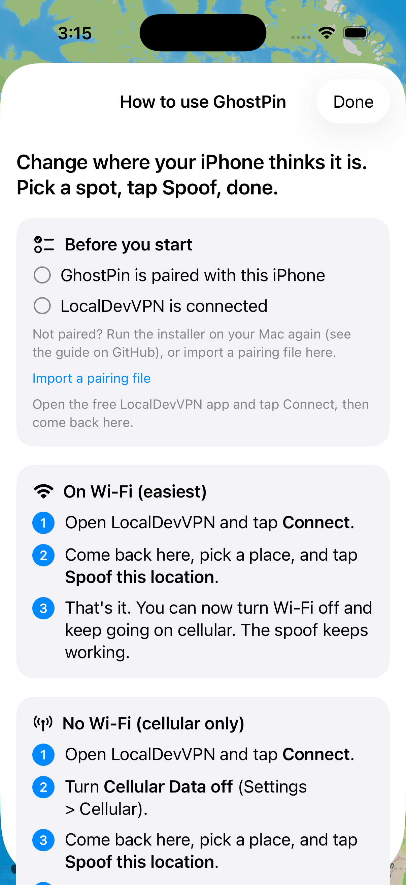
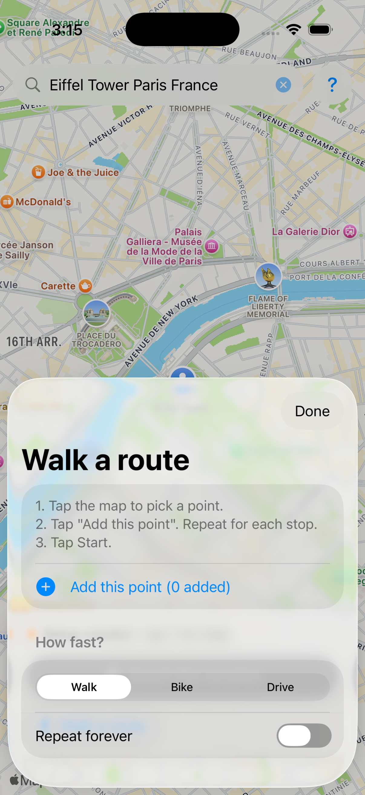

# Using GhostPin

  

The app also explains this itself: tap the **?** button in the top-right corner.

## The three things you need running
1. **GhostPin** is installed and paired (the installer does this).
2. **LocalDevVPN** says **Connected**.
3. A place picked on the map.

In GhostPin's **?** screen, both setup items show a green check when everything is ready.

## Method A: you have Wi-Fi (easiest)
1. Open **LocalDevVPN** and tap **Connect**.
2. Open **GhostPin**, search or tap the map, then tap **Spoof this location**. Do it once to test.
3. That's it. You can now **turn Wi-Fi off** and keep spoofing on cellular. The spoof keeps working, and you can pick new places.

## Method B: no Wi-Fi at all (cellular only)
1. Open **LocalDevVPN** and tap **Connect**.
2. Go to Settings > Cellular and turn **Cellular Data off**.
3. Open **GhostPin**, pick the place, and tap **Spoof this location**.
4. Turn **Cellular Data back on**. Your spoofed location now stays on.

## Walking a route
Tap **Walk a route**, tap the map and **Add this point** for each stop, choose Walk / Bike / Drive, and tap **Start**.

## Going back to normal
Tap **Stop & use my real location**.

## If something goes wrong
- "Couldn't reach your iPhone's location service": open LocalDevVPN, make sure it says Connected, then try Method A or B above.
- Spoof stopped after a while: reopen GhostPin and tap Spoof again.
- App won't open after about a week: free Apple IDs expire apps after 7 days. Plug into your Mac and run `scripts/install.sh` again.
